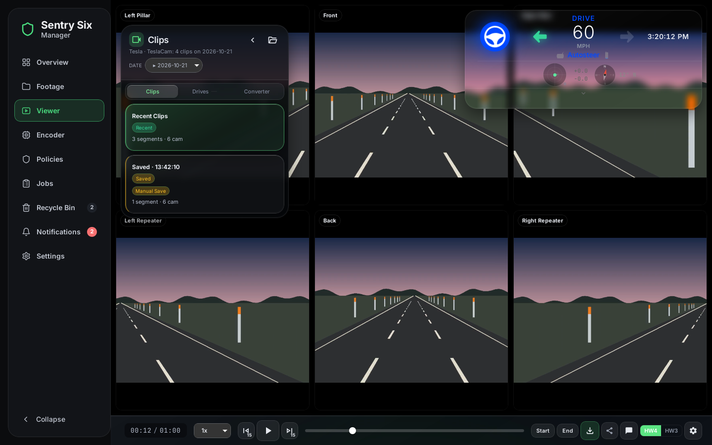

# Sentry Six Manager

[](https://github.com/skittles-fivem/Sentry-Manager/pkgs/container/sentry-manager)

Watch, convert and look after your Tesla's dashcam archive from any browser.
Sentry Six Manager runs on your NAS or home server in Docker. It brings the
[Sentry Studio](https://github.com/ChadR23/Sentry-Six) viewer and converter to
the web, and adds what an always-on archive needs: vehicles on SMB shares, a
Recycle Bin, retention policies, jobs and notifications.



*Screenshots use generated demo footage.*

- **Viewer.** All six cameras in sync, with the telemetry dashboard (speed,
  gear, Autopilot, blinkers, steering, G-force) and the drive on a map. It
  picks the HW3 (four cameras) or HW4 (six cameras) layout from the footage
  itself. Dragging the timeline shows every camera at the second under
  your finger at once, across clips, from small preview frames; the full
  video takes over when you let go. The map (OpenFreeMap, or Google satellite) is fetched by your
  browser straight from those services, so they see which area is on
  screen; no footage is sent anywhere.
- **Encoder.** Converts footage to H.265 or AV1 on the GPU (NVIDIA, AMD
  including APUs, Intel) or the CPU. Tesla's per-frame telemetry is copied
  into every converted file and verified, and nothing is converted twice.
- **Export.** Mark a start and an end in the Viewer, see the clips it
  covers, and download one video of all cameras (or one), with the date,
  time and speed burned in. The server renders it.
- **Footage.** Every recording per vehicle, by day, with what is already
  encoded, filtered by category and date, with Play, Protect and Move to
  trash.
- **Recycle Bin and policies.** Old recordings move to the Recycle Bin on a
  schedule. Nothing is ever deleted unless you empty it yourself.
- **Secure by default.** HTTPS only, with its own certificate, SMB 3 shares
  that are always signed and encrypted, and a web app that never runs as
  root.
- **Phones and tablets.** iPhone 14 and newer, Galaxy S22 and newer, and
  iPads from 2022 on.

## Install

**New here? Follow the [step-by-step install guide](docs/USER-GUIDE.md)**:
every command, what you should see after it, and what to do if you don't
(Linux, Synology, Unraid, TrueNAS, Windows).

The short version, with Docker and Compose 2.24 or newer:

```bash
mkdir sentry-six-manager && cd sentry-six-manager
curl -fsSLO https://raw.githubusercontent.com/skittles-fivem/Sentry-Manager/main/docker-compose.yml
docker compose up -d
docker logs sentry-six-manager
```

Open `https://<server>:9000`, continue past the one-time certificate
warning, and create your account with the **setup code** from the log (the
same page has an unticked *Share diagnostics with the developers* box: leave
it off, or tick it to send crash reports and an hourly heartbeat). Then
**Settings → Add vehicle**: an SMB share, or a folder you mount into the
container (see [Vehicles and SMB shares](docs/vehicles-and-shares.md)).

On TrueNAS SCALE, install it as a custom app: [TrueNAS](docs/truenas.md).

The compose file publishes two ports: **9000**, the app, and **10000**, the
device port the CAN Bridge and the Sentry USB in the car connect to. Keep both
published; nothing listens on 10000 until one of them is set up.

## Update

```bash
docker compose pull && docker compose up -d
```

**Settings → Updates** shows the build you run (for example *Build 128 ·
Nov 11, 2026*: give this number when you ask for help) and says when a newer
one is out; it never installs anything itself. Your account, settings and footage stay, and a conversion
that was running carries on by itself. More in [Updates](docs/updates.md);
on TrueNAS, run `sudo docker pull ghcr.io/skittles-fivem/sentry-manager:latest`
in *System → Shell*, then stop and start the app ([TrueNAS](docs/truenas.md#updating)).

## Documentation

| | |
| --- | --- |
| [Install guide](docs/USER-GUIDE.md) | Step by step, for every system, with what to do when something goes wrong |
| [TrueNAS](docs/truenas.md) | Installing and updating as a TrueNAS SCALE app |
| [Overview and Footage](docs/overview-and-footage.md) | The server's live stats, logs, and browsing recordings |
| [Encoder](docs/encoder.md) | Converting footage, GPUs, several GPUs at once, other servers as nodes |
| [Export a video](docs/export.md) | Making one video of a stretch of footage, and its limits |
| [Recycle Bin, policies and jobs](docs/recycle-bin-and-jobs.md) | Retention, restoring, and what the server is doing |
| [Vehicles and SMB shares](docs/vehicles-and-shares.md) | Footage on a share or on the same machine, permissions |
| [Sentry USB](docs/sentry-usb.md) | The Pi that archives the car's clips: pairing it and managing it from the Sentry USB tab (status, the car's battery, temperatures and tires, settings, updates), and converting without upsetting its checks |
| [Sentry USB link](docs/sentry-usb-link.md) | Pairing the Pi and managing it from here (status, settings, updates, queued actions, security log): the contract both sides build to |
| [CAN Bridge](docs/can-bridge-api.md) | The car's own data (speed, battery, 12 V system, temperatures…) from a Screenmate One, synced to the footage in the Viewer (its car-data bar is off until turned on in the Nerd settings) |
| [Phones and tablets](docs/phones-and-tablets.md) | Supported devices |
| [Updates](docs/updates.md) | Updating, critical updates, how images are built |
| [Automatic updates](docs/auto-updates.md) | Watchtower, to install new versions for you |
| [Security](docs/security.md) | HTTPS and the certificate, sign-in, what runs as root |
| [Privacy](docs/privacy.md) | Everything that leaves your server: what goes out by itself, and what the developers get only if you opt in |
| [Your own interface](docs/interface-packs.md) | The four interface packs, and making your own |
| [Settings](docs/settings.md) | Every `.env` setting |
| [Development](docs/development.md) | Building and testing |

## Not in the web version (yet)

- Clip sharing, the Advanced Editor's export options (blur zones,
  dashboard styles, minimap) and the SentryUSB drive tools from the desktop
  app; the Viewer leaves them out.
- Desktop-only converter options (keep running when closed, start with
  Windows).

## Credits and license

The viewer and converter are [Sentry Studio](https://github.com/ChadR23/Sentry-Six)
by Chad and Scott Vandereems. Released under the [MIT License](LICENSE).
