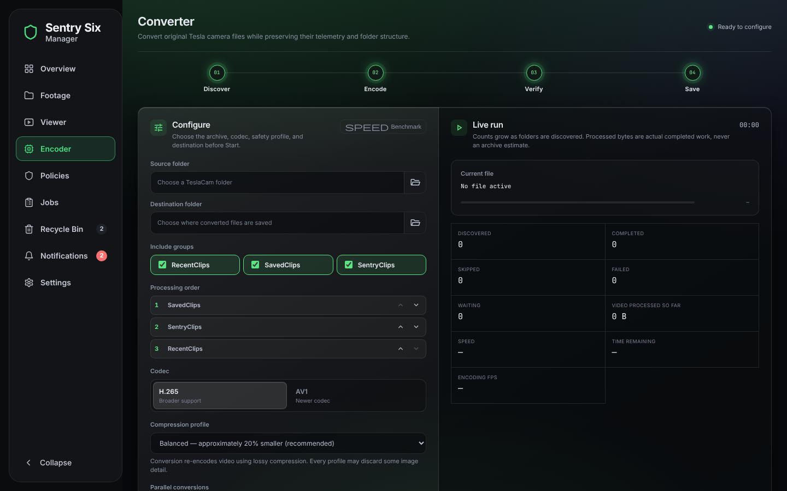

# Encoder

[← Back to the README](../README.md)

The Encoder is Sentry Studio's converter. It converts the
selected vehicle's footage straight on its share to save space, so more
fits before old recordings have to go: by default each original is replaced
by its verified H.265 or AV1 version (when the share supports a safe
replacement; see below). Keeping the originals and writing the converted
copies somewhere else is a choice you make in the Output section.

**Automatic conversion is per vehicle.** Pick a vehicle at the top of the
Encoder, choose its settings, and tick *Convert this source's new clips
automatically*: that vehicle's new clips are converted on the schedule with
those settings (codec, profile, output, parallel conversions), saved for it
alone. Vehicles you leave unticked are never converted by themselves. The
list under the checkbox shows which vehicles convert automatically and with
what. The schedule, the time window and off-peak are shared: each check goes
through the automatic vehicles one after another, one conversion at a time,
and a vehicle whose share is down doesn't hold up the others. Settings are
changed while nothing is converting (the vehicle picker is locked during a
conversion).

**Encoding per vehicle** (Encoder → *Encoding per vehicle*; in the example
interfaces, its own page next to the Encoder) shows one card per vehicle with
what it converts with, in plain words: codec, size (profile and about how much
smaller, quality level or custom bitrate), whether clips that miss the target
are kept, output (replace originals or a separate folder), verification, clip
groups and their order, devices, and automatic conversion with its schedule.
*Edit* (or *Set up* for a vehicle with nothing saved) changes them with the
same checks as a run you start, including the confirmation for replacing
originals; settings can be saved with automatic conversion off, and turning
it off keeps them. In the Encoder, the picked vehicle's saved settings show
in one line ("Model 3 saved settings: H.265 · Balanced · Replace · Quick")
with *Load these*, which fills the form only when you click it.

- **Telemetry is always kept.** Tesla stores speed, GPS, gear, Autopilot and
  more in every video frame. The converter copies that into the H.265 or AV1
  file and checks it before it saves anything. Verification cannot be turned
  off.
- **Never converted twice, and skipped at once.** The app remembers every
  clip it converted (name, size and date in the data folder), and checks
  other clips' MP4 header while it scans the folders, so clips that are
  already H.265 or AV1 are skipped right away and never wait for a
  conversion slot. Waiting and time remaining count only clips that will be
  converted.
- **Hardware panel.** While a conversion runs, Live run shows the encoder
  and GPU in use, video-engine and CPU load, watts and temperatures, and the
  energy used so far (Wh or kWh, clips and GB saved per kWh, cost), beside
  the run's progress (current file, waiting, time remaining and the other
  counters), so how many are left shows without scrolling on a computer; on
  a phone the progress comes first and the panel under it. The clips being
  converted are not listed one by one (they come and go every few seconds).
  Clips and GB per kWh count only what was converted while the energy was
  measured, so they start at 0 and count up as clips finish: until 10 Wh
  have been measured they are divided by 10 Wh, so a clip or two never reads
  as a huge number (a job that was already running when measuring began, for
  example before a restart, is not divided by a few minutes of energy
  either). When the server reports the GPU's power but not the CPU's, they
  count the GPU alone and say *GPU only* (not with a built-in GPU, whose
  reading is the whole chip's).
- **Benchmark.** Runs the real converter on copies of a few of your clips
  at 1, 2, 4, 6 and 8 at once, on the server, and suggests the lightest
  setting within 5% of the fastest, and, when the server reports its power,
  the most efficient one (files per kWh). Your footage is only read. It
  needs original (H.264) clips and looks for them, newest first, through the
  whole source folder, so an archive that is mostly converted works too.
- **Safe replacement.** In replace mode an original is only removed after its
  converted copy is verified, and only if it is still exactly the file that
  was converted (device, inode, size and SHA-256 are checked). The copy is
  moved in with a no-replace rename, which also holds on SMB. Clips copy
  their conversions to the share at the same time; only the renames that
  swap a clip in go one clip at a time. Each copy is read back in full right
  after it is written; in the swap the original gets a full check right
  before it is moved aside, and the copy and the moved original are then
  checked by device, inode, size and modification time (fully again if any
  of those changed). On the Encoder page, "Save / replace" includes the copy
  and "Wait to save" is the wait for those renames.
- **Separate destination**, if you pick it: the originals stay and the
  converted copies go to a folder you choose (under `/data/converted` or a
  vehicle's share). If the share cannot guarantee a safe replacement, this
  is the only option offered.
- **Time remaining covers every clip.** The scan finds the whole archive
  (up to 50,000 clips per job) while the first clips convert; until it
  reaches the end, Discovered shows a `+` and the time remaining reads
  "at least".
- **Long runs don't stall.** A clip that is moved or deleted while a job
  runs (the Recycle Bin, a policy, the car) fails as `source-missing` and
  the job goes on. A share that stops answering pauses the job until it is
  back. An encode that reports no progress for 10 minutes (a stuck GPU or
  share) is stopped and redone the slower way, or fails. The automatic
  window resumes its job even when the pause had not taken effect yet.
- **Unusual Tesla clips convert too.** Some clips start partway into a
  group of frames, or have a frame Tesla's encoder skipped; both convert
  with every frame at its original time and the telemetry intact, and are
  verified like any other clip.
- **Every clip ends up in one codec.** With *Constant quality* or a custom
  bitrate, a clip that does not come out smaller (busy repeater footage,
  night, rain) is encoded again at 85% of its original bitrate, then 60%,
  instead of staying H.264. Only if even that is not smaller is the
  original kept.
- **Size profiles** (5%, 20%, 50% smaller) retry a clip that comes out too
  big at a lower bitrate; *Keep clips that can't reach the size target*
  (off by default) then keeps it anyway, if it is smaller than the original
  and passed every other check, and marks it "kept: 14% smaller (target 20%)".
- **Gave up is not forever.** The automatic window stops retrying a clip
  after it fails three times, or when converting it would not save space.
  When an update changes the converter, those clips are tried again once.
- **After a restart** the Encoder page shows the job that is running now,
  even if the page was left open while the server restarted.

## GPU

The converter uses the first GPU encoder that passes a real test encode,
in this order: NVIDIA (NVENC), Intel (QSV), AMD (AMF), then VA-API. Without
a working GPU encoder it encodes on the CPU (libx265 for H.265, SVT-AV1 for
AV1), and a clip the GPU fails on is redone on the CPU. With a GPU, the
original is decoded on the GPU too. In `docker-compose.yml`, turn on the
GPU's block: every optional line starts with `#` in the first column, and
deleting just that `#` turns it on, already lined up.

| GPU | Encoders | What to uncomment |
| --- | --- | --- |
| NVIDIA | `hevc_nvenc`, `av1_nvenc` | the `deploy:` block (needs the NVIDIA Container Toolkit) |
| AMD card or APU | `hevc_vaapi`, `av1_vaapi` | `devices: - /dev/dri:/dev/dri` |
| Intel iGPU or Arc | `hevc_qsv`, `av1_qsv`, VA-API | `devices: - /dev/dri:/dev/dri` |
| none | `libx265`, `libsvtav1` | nothing |

ffmpeg is [jellyfin-ffmpeg](https://github.com/jellyfin/jellyfin-ffmpeg),
which the Jellyfin team keeps on the current FFmpeg release with its own
VA-API drivers. AMD's AMF encoder needs AMD's proprietary driver, which
containers don't have, so AMD cards and APUs use VA-API; AV1 needs RDNA3 or
newer. **Settings → System** lists the GPUs the container can see.

**Mac (Docker Desktop):** containers run in a Linux virtual machine that
macOS gives no GPU to, so on a Mac (Apple Silicon or Intel) conversions
always use the CPU encoder; no setting can change that. Settings → System
says so. A Linux or Windows computer with a GPU can encode for it as a node.

## Several GPUs or CPUs

Pass the whole of `/dev/dri` (and, for NVIDIA, every GPU in the `deploy:`
block). With two or more GPUs, **Parallel conversions** in the Encoder shows
one row per GPU plus a CPU row: set how many clips each one converts at
once, 0 for Off. Each GPU takes the next clip whenever it is free, so a
faster card simply converts more of them, and the numbers can be changed
while a job runs. A GPU that cannot encode the chosen codec (AV1 on an
Intel UHD 770, say) shows "Can't encode AV1". With one GPU nothing changes.

The benchmark tests every GPU on its own, one after another, and shows each
GPU's results separately, with a button to use each GPU's best setting at
once. GPUs are told apart by their PCI slot, so a reboot that numbers them
differently changes nothing; the old trick of mapping one GPU to
`/dev/dri/renderD128` still works but is no longer needed.

Several CPUs: on a server with two or more CPU sockets, **Overview → Server**
shows "2 × <CPU model>" and each socket's use, temperature and package power
(CPU 1, CPU 2, …); the CPU temperature is the hottest socket.

## Nodes: other servers that encode

Another computer running Sentry Six Manager (a gaming PC with a better GPU,
say) can encode clips for this one. It becomes one more row under
**Parallel conversions**, next to this server's GPUs and CPU.

1. On the other computer, open **Nodes → Let another server use this one →
   Show pairing code** (asks for its password). The code works once, for 10
   minutes.
2. Here, open **Nodes → Add node** and enter that computer's address and the
   code (asks for this server's password).
3. Under **Encoder → Parallel conversions**, set how many clips the node
   converts at once. That is the one place to set it: the node is told the
   number when a conversion starts or the row changes (at most 8, the most a
   node runs).

**Rename** gives a node a name of your own here (shown on the Nodes page and
under Parallel conversions); the node keeps its own name. On the node,
**Encode with** chooses how it encodes: its **GPU** (the default; the CPU only
on a computer without one), **GPU, then CPU if it fails**, or **CPU only**. A clip the node can't encode comes back here.

**Vehicles first** (per node, on the Nodes page) gives a node its own
vehicles for automatic conversion, in order. Automatic conversion then runs
a conversion per vehicle at the same time, each on devices of its own: a
node converts for the first vehicle on its list that has new clips, while
this server's GPU and CPU convert another vehicle. With none of its vehicles
waiting, the node helps the others (the vehicle on this server's GPU, if its
settings use the node). When its vehicle has new clips again, the node
finishes the clips it has and goes back to it. A vehicle left with no device
waits, paused, until one is free. A node with no list helps whichever vehicle
is converting, as before. Conversions you start yourself still run one at a
time.

**Benchmark a node** from here: **Nodes → Benchmark** (or **Benchmark AV1**)
lends the node a few sample clips from your footage and converts them at 1,
2, 4, 6 and 8 at once, timing each level. The node needs no footage of its
own; the encoded files are deleted and the footage is only read. It lends
original (H.264) clips, newest first, from anywhere in your footage; when the
Encoder has converted them all, it lends converted ones and says so. **Use N
at once** then sets the node to the lightest setting within 5% of the
fastest, and its row under Parallel conversions too.

This server reads each clip from the share, sends it to the node over HTTPS,
gets the encoded file back, and then writes the telemetry, verifies it and
saves it exactly as it does for its own GPUs. Each node is sent **15 clips
ahead** of what it converts at once: they wait on the node, so it starts the
next one the moment a slot is free instead of waiting for this server to read
and send it (the Nodes page shows how many are converting and waiting, and
the Encoder shows them apart: "Converting 4 files at once · 15 waiting on a
node"). Setting the node's row lower or **Off** in the Encoder takes back the
clips still waiting there: they go back to this server's queue (not counted
as failed or as a try), and the node only finishes the clips it has started.
A node set to Off for a vehicle stays off for it, even with that vehicle on
its Vehicles first list. This
takes up to 15 clips' worth of disk on the node, about 1 GB, and on this
server while they wait. If a node stops converting for 30 minutes, the clips
waiting on it are encoded here instead. If a node is offline or fails
a clip, that clip is encoded here instead (two at a time, so a node's whole
queue failing over never swamps this server), on this server's GPU when it has
one (the CPU otherwise).

Security:

- **Nodes never touch your footage.** They get one clip at a time and send
  one file back. They never see share passwords and cannot delete or replace
  anything; only this server writes to the share.
- **Pairing can't be intercepted.** Each side proves it knows the code with
  a signature over the certificate it actually saw, so a machine in between
  cannot pair. A few wrong codes from one address and that address is
  refused; the code stays valid for the right main.
- **Pinned certificates.** From then on this server only talks to the node's
  own certificate, or one renewed by the node's own certificate authority.
  Anything else is refused before a byte is sent. A node that was reset has
  to be paired again.
- **Tokens, not passwords.** Every request carries a random token. The node
  keeps only its hash, and **Revoke** on the node (or **Remove** here) ends
  it at once.
- **Fixed settings only.** A node accepts the codec, a bitrate or quality
  level and nothing else. It builds its own ffmpeg command and runs it as
  its unprivileged app user.
- **Nothing is trusted on the way back.** Every file a node returns is
  compared picture by picture with the original here (black, blurred or
  swapped footage is caught and the clip is encoded here instead; both are
  decoded on this server's GPU when it has one), then
  verified like any other (frames, timing, telemetry) before an original is
  replaced. A clip of 20 seconds or more is compared on three 3-second
  stretches at random places, picked only once the encode is back, so the
  node can't know which; about a quarter of the decoding of every frame.
  **Trusted** (per node, on the Nodes page, off by default, asks for the
  password) skips the picture comparison for a computer of your own; the
  verification of frames, timing and telemetry still runs. "Where the time
  goes" shows the picture check and the wait for it on lines of their own. A node can never send back more than twice the clip's size, and
  one that stalls or misbehaves cannot hold up this server.
- **A main can't misuse a node either.** The node reads each upload strictly
  as an MP4 from its own work folder (so it can't be pointed at other files
  or addresses), caps the output's size and length, and keeps a limited
  number of clips at a time.
- Only pair computers you own: a picture comparison catches swapped or
  blanked footage, not a small change to part of the picture.

**Power across servers.** Each node reports its own power (CPU and GPU
watts, and its energy today and this week) to the main over the same pinned
connection, about every 30 seconds. With nodes paired, the Overview's Power
tile (and the power card of every interface) shows **All servers** first:
the total of this server and every node that reports, then a line per server
with its CPU and GPU watts. A node that is offline, has not answered for over
a minute, or runs an older version is listed as offline or unknown and left
out of the total. Costs of a node's energy use this server's electricity
price. A conversion's energy (the Encoder, Jobs) includes the nodes that
converted its clips: their readings while they held its clips, which also
counts their idle power. Readings come every 30 seconds or so, so it is an
estimate. Only numbers are sent: watts, watt-hours and GPU names.

A node needs its own HTTPS (the default; not `TLS_MODE=off`). It uses the
same port as its web page, so there is nothing to add to `docker-compose.yml`.
