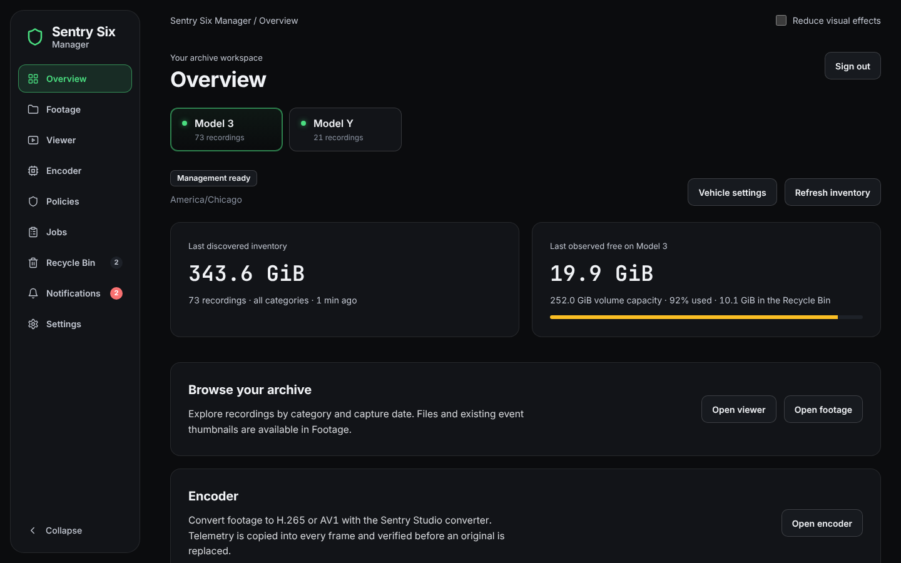
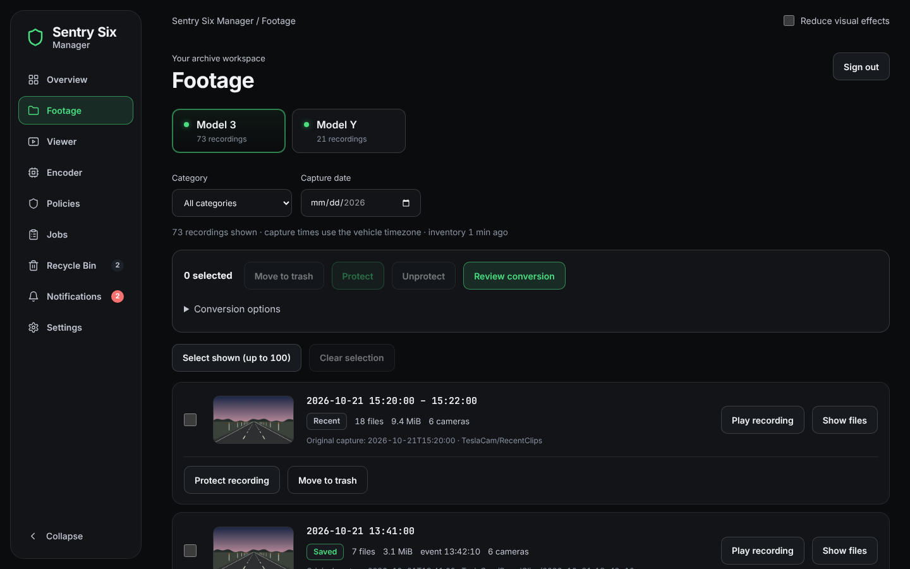

# Overview and Footage

[← Back to the README](../README.md)

The overview is one window, **Server**. At its top, the selected vehicle's
archive (its size, how many recordings, when it was last scanned, with
*Refresh inventory*) and the free space on its share (capacity, how full it
is, what the Recycle Bin holds, with *Vehicle settings*). A chip shows only
when the share has a problem: *Read-only share* or *Share unavailable*.

Under them, behind the *Nerd stats* switch, what the machine is doing, live,
so you don't need Glances or another tool:

- **CPU**: model, cores, total and per-core use, clock, temperature, load,
  and how much of it this app and its conversions use.
- **GPU** (Intel, AMD and NVIDIA, one tile each): busy and video-engine use,
  memory, clock, temperature, watts.
- **Power**: CPU and GPU watts, the energy used today and this week (in Wh
  below 1 kWh), and the cost when you enter your electricity price in
  Settings → System. A built-in GPU (an APU such as the Ryzen 8700G's
  Radeon 780M) is part of the CPU chip, so the CPU and that GPU show as one
  figure, *whole chip*; a graphics card besides it gets its own bar.
- **Memory, storage** (each disk's reads, writes and temperature; space and
  answer time of the data volume and every footage share, checked every 10 s,
  with when it was last checked; a share that is offline shows *not
  connected* and when it last answered, kept across restarts), **network** (live
  speed, and the data used today, this week and this month) and every
  **sensor** and fan the server reports.
- **Top processes**: up to 40, eight at a time (scroll the list for the
  rest). Busy ones come first; the others keep their places, so the list
  does not reshuffle with every update.
- The numbers update every 2 seconds without moving the page, and wait while
  you highlight text in them, so it can be copied.
- **Alerts** for a hot CPU, GPU or disk, a disk almost full, a slow or
  unreachable share, and low memory; they also go to Notifications.
- **History**: the last 24 hours, and a CSV download.
- **Logs** at the bottom, with Nerd stats on or off: the warnings and errors
  the server keeps (see [Security](security.md)); an alert's *Logs* link goes
  there.

It only measures while a page shows it or a conversion runs (and reads the
network's byte counters once a day, so the data used lands on the right
day), and every number stays on the server. A tile appears only when the server provides its
numbers. CPU watts come from the CPU's energy counters: remove the `#` from
the `powercap` line in `docker-compose.yml`
(`- /sys/devices/virtual/powercap:/host/powercap:ro`) on a server that has
them (`ls /sys/devices/virtual/powercap` shows a folder; most Intel and AMD
PCs and NAS boxes do). It is off by default because Docker refuses to start
the container where that folder does not exist (a Raspberry Pi, some mini
PCs and VMs, Windows/WSL); Overview → Server says when it is worth turning
on. On Docker Desktop for Windows (WSL2) and inside other virtual machines
CPU watts cannot be read at all, so the power tile says so instead of
suggesting the line; GPU watts still show when the card reports them (NVIDIA
does). One optional line
adds the whole server's processes and network (`pid: host`); it also lets
the container see and signal the server's processes, so use it only with a
PUID/PGID of its own.

**Footage** shows one card per day, newest first, all closed until you open
one: a thumbnail (the day's first Sentry or Saved event, else its first
drive), its drives and events, how long and how big it is, and a blue
**Encoded** badge once its recordings are converted to H.265 or AV1
(*Encoded 1/4* while only some are; the codec is read from each clip's MP4
header). For the whole day:

- **Play day** opens the Viewer on that day.
- **Delete this day** and **Delete through this date** (that day and every
  older one) move its recordings to the Recycle Bin. You see how many and
  how big first; protected recordings stay, and nothing is deleted for good
  until you empty the Recycle Bin.

Open a day to see its recordings: play one, show its files, protect it, or
move it to the Recycle Bin. A day stays open until you close it, and picking
a date in the filter opens that day. The checkbox on a day selects all of
its recordings.

**Show files** lists a recording's clips with each one's codec (H.264, H.265
or AV1), says how many are not encoded yet, and *Not encoded only* hides the
rest, so a clip the Encoder skipped or could not convert is easy to find.
