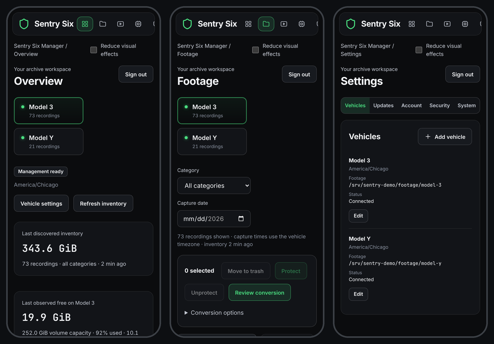
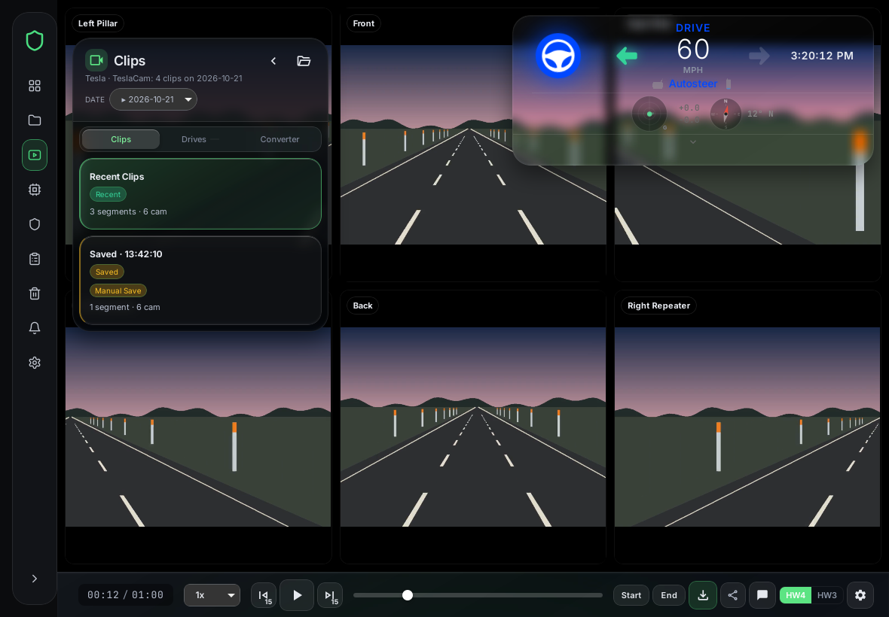

# Phones and tablets

[← Back to the README](../README.md)

Works in Safari on iPhone 14 and newer (iOS 16 or later) and on iPads from
2022 on (iPad 10th gen, Air 5, Pro M2, mini 6 and newer), and in Chrome or
Samsung Internet 22+ on Galaxy S22 and newer phones, Folds and Tabs, in
portrait and landscape.

- The dashboard and map panels move with a finger; the timeline is a normal
  slider. On phones the Viewer is shrunk to fit, so turn the phone sideways
  for a bigger picture.
- The Viewer pauses when you switch to another page, so it doesn't drain
  your battery in the background.
- H.264 (the car's own recordings) and H.265 play everywhere. AV1 plays in
  Safari only on iPhone 15 Pro and newer and on iPads with an M3, M4 or A17
  Pro chip. If you watch on older iPhones or iPads, convert to H.265.
