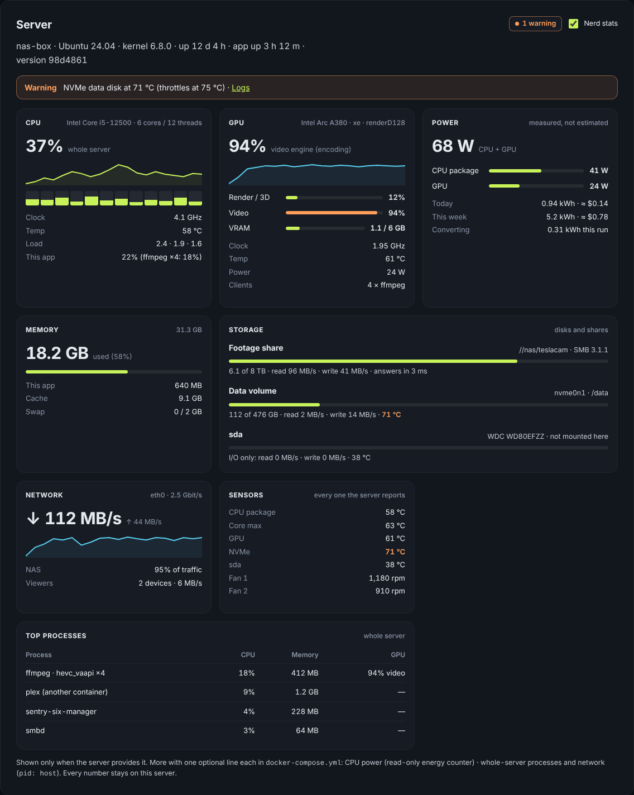
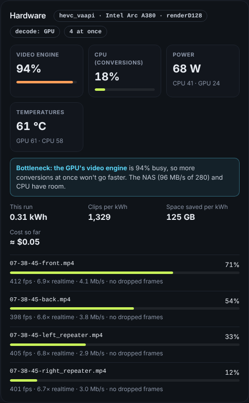

# Next update: built-in server monitor ("nerd stats")

Status: approved by the owner (mockup below), not built yet.

**Owner's rule:** build the whole plan (all steps) for `main`, but push it
to `main` only after the owner has checked the look (see `CLAUDE.md`).

Goal: one place in the app that shows what the server is doing, on any
hardware, so nobody needs Glances, Netdata or other tools. Everything stays
inside the one container; nothing leaves the server; no extra services.

Mockup (sample numbers; markup and CSS in `server-monitor-mock.js`; the
Encoder panel as first approved, see the notes under "Encoder" for what
changed since):

## Overview: "Server" section (behind a "Nerd stats" toggle)

Header: host name, OS, kernel, uptime, app uptime, version; warning chip.

| Tile | Shows | Source |
|---|---|---|
| CPU | model, cores/threads, total % + 15 min sparkline, per-core strip, clock, temp, load, this app % vs whole server | `/proc/stat`, `/proc/cpuinfo`, `/proc/loadavg`, cpufreq, hwmon (coretemp/k10temp), cgroup `cpu.stat` |
| Memory | used/total, cache, swap, this app | `/proc/meminfo`, cgroup `memory.current` |
| GPU (one tile per GPU) | name, driver, busy %, video engine %, VRAM, clock, temp, watts, clients | AMD: `gpu_busy_percent`, hwmon `power1_average`, `mem_info_vram_used`; NVIDIA: one long-running `nvidia-smi --query-gpu=... --format=csv -lms 2000`; Intel i915/xe and AMD per process: DRM fdinfo `drm-engine-*` of our ffmpeg children (kernel 5.19+, no root needed) |
| Power | CPU package W, GPU W, kWh today/week, cost (price per kWh in Settings) | RAPL `energy_uj` (root only: read by the supervisor and sent over IPC; Docker may mask powercap, so document one optional read-only compose line), GPU power as above |
| Storage | per disk read/write and temp; space for /data and footage shares; NAS answer time | `/proc/diskstats`, `/sys/block`, statfs, drivetemp/nvme hwmon, a timed stat on the share |
| Network | rx/tx + sparkline, share of NAS traffic | `/proc/net/dev` (container namespace; whole server with `pid: host` via `/proc/1/net/dev`) |
| Sensors | every temperature and fan the board reports | `/sys/class/hwmon`, `/sys/class/thermal` |
| Top processes | CPU / memory / GPU per process | the container's processes; whole server only with optional `pid: host` |
| Alerts | hot disk, throttling CPU/GPU, disk almost full, NAS slow/offline | thresholds -> Notifications + Overview > Logs |

Rules: detect once what the machine provides and show only those tiles;
"Shown only when the server provides it" footer lists the optional compose
lines and what each unlocks. Works on Intel, AMD, NVIDIA and ARM (Pi:
thermal zone only for the GPU).

## Encoder: "Hardware" panel in Live run

- Chips: encoder + device (e.g. `hevc_vaapi · Intel Arc A380 · renderD128`), decode GPU/CPU, N at once.
- Tiles: video engine %, CPU used by conversions, watts (CPU / GPU), temperatures.
- (Bottleneck hint: removed later at the owner's request; it flipped between "bottleneck" and "room to spare".)
- Efficiency: kWh this run, clips per kWh, GB saved per kWh, cost so far.
- One row per running clip: progress bar, fps, speed x realtime, bitrate, dropped/duplicated frames (from the ffmpeg `-progress` output jobService already reads).
- (One row per running clip: removed later at the owner's request; the clips came and went every few seconds. The panel now sits beside the run's progress (current file and counters) instead of above it, so how many are left shows without scrolling. The mockup above still shows the first version.)
- Benchmark: watts per level and a "most efficient" pick next to "fastest".
- Jobs page: kWh and average W per finished run.

## How it runs

- `server/stats.js` sampler, every 2 s, only while a page is open (SSE subscriber) or a conversion runs; 15 min ring buffer for sparklines.
- Privileged readings (RAPL) only in the supervisor, fixed read-only paths, sent over the existing IPC channel.
- Delivered over the existing SSE channel (`announce`) or `GET /api/stats` (signed-in only).
- Pause sampling when the tab is hidden.

## Build order (each step: tests + phone and desktop screenshots before main)

1. CPU, memory, sensors, storage, alerts; Encoder per-clip rows.
2. Live GPU numbers (AMD sysfs, NVIDIA nvidia-smi stream, Intel/AMD fdinfo).
3. Power: GPU W, CPU W via supervisor + optional compose line, kWh/cost per run, benchmark files per kWh, Jobs energy.
4. Optional: 24 h history graphs, per-core heat strip, CSV export.

## Also in the next update: already-converted clips skip instantly

Reported by the owner: after deleting footage and updating, a new run skipped
already-converted clips slowly (23 skipped in 78 s with 21,791 waiting, ETA
20 h). Cause: the skip check is inside `processVideoOnce`
(`src/main/converter/jobService.js`): each clip waits for a free encode slot,
then ffprobe reads it over SMB, and only then is it marked
`already-converted`. Skips are throttled by encoding, and the ETA counts
clips that will only be skipped. Nothing remembers what was converted.

Plan:
1. A converted-clips index in /data (path + size + mtime + inode -> codec),
   written when a clip is converted or a probe finds H.265/AV1. Discovery
   already stats every file, so a matching entry is skipped at once without
   opening the file (the "tags" the owner expected, kept in the app instead
   of in the files).
2. For clips not in the index: a separate fast check during discovery (read
   the MP4 sample entry, `avc1` vs `hvc1`/`hev1`/`av01`, from the moov box,
   first/last few hundred KB) with its own concurrency, so skips never take
   an encode slot.
3. Waiting / time remaining count only clips that will really be encoded.
4. Test: 20,000 converted + 100 original clips -> all skips done within
   seconds, encode slots only see originals.

## Also open from this session

- Owner to check on a real iPhone that all 6 Viewer cameras play (WebKit 27.2 on the PC stalled 4 of 6; WebKit 26 here played all 6).
- Re-run the benchmark on 98d4861+ and read the `Verification failed` line in Overview > Logs for the duration-mismatch clip (damaged clip or converter issue?).
- The owner's archive (44,375 clips) is near the 50,000 items per job cap.
- "Closing file descriptor N on garbage collection" warnings in the server log: not traced yet.
- Delete the leftover branches (release/flight-deck, encoder-flight-deck, flight-deck-preview, pc-test/*); keep main and backup/pre-flight-deck.
- Offer: skip clips that already have a converted copy in separate-output mode instead of re-encoding.
