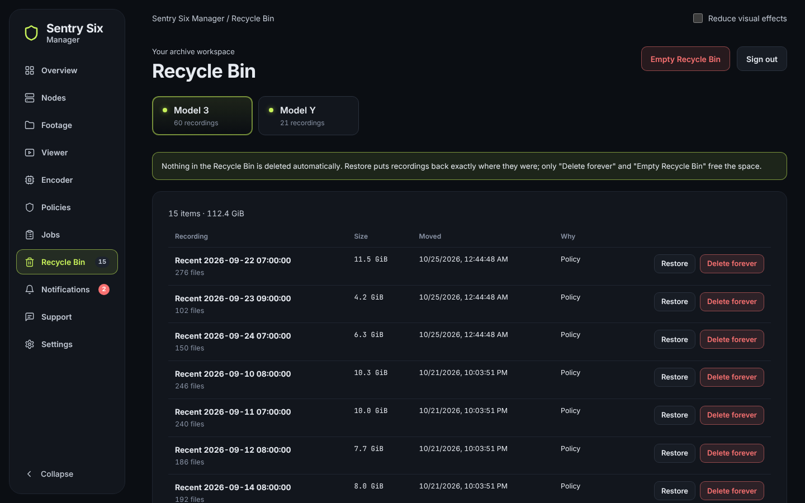
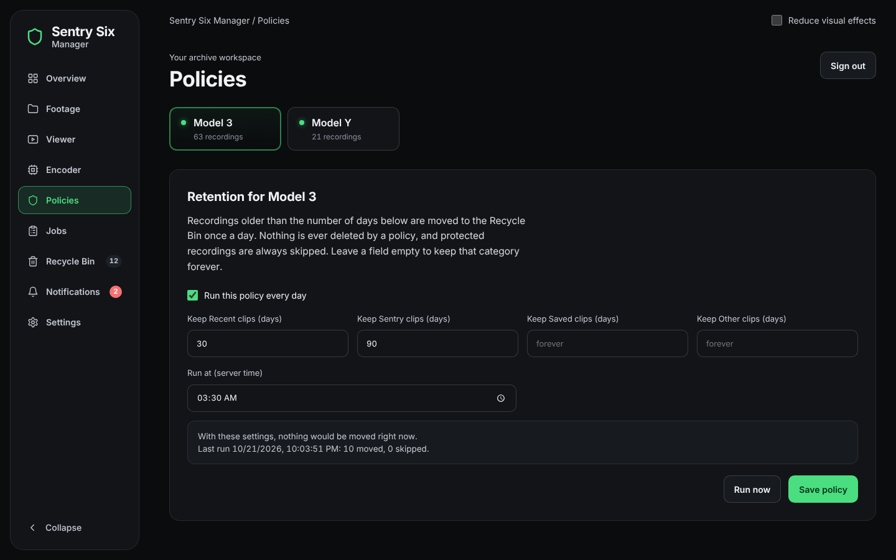

# Recycle Bin, policies and jobs

[← Back to the README](../README.md)

**Move to trash** moves a recording into `.sentry-recycle-bin` on the same
share. That is a rename, so it is instant. From the Recycle Bin you restore a
recording to exactly where it was, or delete it for good, which always asks
you to confirm (and for your password, unless you entered it in the last 10
minutes). Protected recordings, and recordings the converter is working on,
can't be trashed.

CAN Bridge logs go with their footage: when footage is deleted for good, the
logs of the same car and minutes go too (while it is only in the Recycle Bin
they stay). See "How long logs are kept" in [can-bridge-api.md](can-bridge-api.md).

A **policy** keeps a number of days per category (Recent, Sentry, Saved,
Other) and moves older recordings to the Recycle Bin once a day. It previews
what the next run would move. Protected recordings are always skipped.

**Empty the Recycle Bin after (days)**, on the same page, is off by default:
then nothing is deleted for good until you empty the bin. With a number,
each daily run deletes what has been in that vehicle's bin longer than
that, and the policy's last result says how much it freed.

## Jobs

**Jobs** lists what Sentry Six Manager did and is doing for the selected
vehicle: inventory scans, conversions (with the energy they used), moves to
and from the Recycle Bin and policy runs, newest first, with how long each
took. A job that a restart stopped (a scan, a move) shows as *interrupted*;
a conversion carries on where it was.

**Clear jobs** takes the finished ones (done, failed, cancelled and
interrupted) off the list after you confirm how many, so what shows up next
is what happened since. Running, waiting and paused jobs stay. Only the list
is cleared: footage, converted files and what the Encoder needs to resume a
conversion are not touched.

**Keep the footage under (GB)**, also on the Policies page and off by
default: at each run, once the car's footage is over that size, its oldest
recordings that are not protected move to the Recycle Bin until it is under
(after the days rules). They still take room until the bin is emptied, by
hand or with *Empty the Recycle Bin after*.
