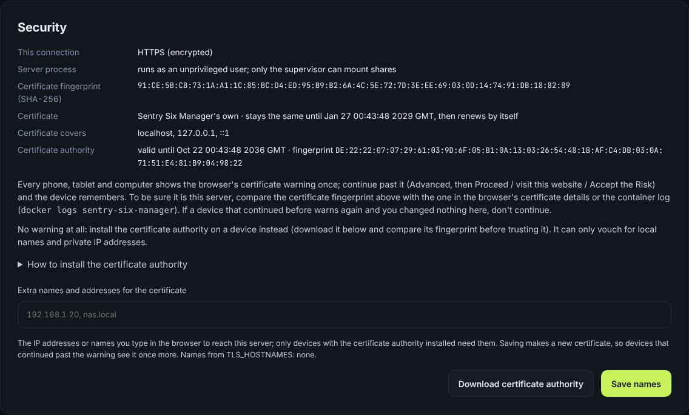

# Security

[← Back to the README](../README.md)



**HTTPS only.** Port 9000 speaks HTTPS (HTTP/2), so nobody on your network
can read your password or footage, or change the page. Plain HTTP on the
same port never shows the app: every request is redirected straight to the
HTTPS address. Manager sends no HSTS header: with its own certificate it
would remove the browser's "continue" button on some devices, and force
HTTPS on every other port of the NAS's address.

Sentry Six Manager makes its own certificate, so browsers don't know it:

- **Continue once per device.** The first time, each phone, tablet and
  computer shows a warning; continue past it (Chrome, Edge, Samsung
  Internet: Advanced, Proceed; Safari: Show Details, visit this website;
  Firefox: Accept the Risk) and the device remembers it (Chrome may ask
  again after a while). The certificate stays the same for over two years,
  so devices are not asked again on every update.
- **Check it is your server.** The certificate's SHA-256 fingerprint is in
  `docker logs sentry-six-manager`, on the sign-in page and in
  **Settings → Security**; compare it with the browser's certificate
  details. If a device that continued before warns again and you changed
  nothing, don't continue.
- **No warning at all (optional):** install Sentry Six Manager's
  certificate authority on a device. Download it in **Settings → Security**
  (or copy `data/tls/ca.crt`), compare its fingerprint with the log, and
  install it (the steps for iPhone, Android, Windows, macOS and Firefox are
  on that page). For those devices, add the address you type in the
  browser under **Settings → Security** so the certificate covers it;
  saving new names makes a new certificate, so devices that only continued
  past the warning are asked once more.

The certificate authority can only vouch for local names (`.local`, `.lan`,
...), private IP addresses and names you add, so even a stolen key could not
be used against other websites. Its key never leaves the root-only folder
`data/tls`. Behind your own reverse proxy, set `TLS_MODE=off` and
`TRUST_PROXY=true`, or bring your own certificate with `TLS_CERT_FILE` and
`TLS_KEY_FILE`.

**Signing in.** The first account needs the one-time setup code. Repeated
wrong passwords slow down further attempts, and an address that keeps
failing is banned for a while (see [Bans](#bans-after-failed-sign-ins)). Cookies are HttpOnly,
SameSite=Strict, Secure and `__Host-` prefixed, every change must come from
the page itself, and every page runs under a strict Content-Security-Policy.

**Your password again** is needed for changes that could hand someone your
shares or the server: adding a vehicle or changing its footage source, the
certificate names, and deleting from the Recycle Bin for good.

**No root for the web app.** Only a small supervisor runs as root, to mount
shares and keep the certificate authority, and it never loads anything from
`/data`. The web app and ffmpeg run as `PUID:PGID` with no capabilities and
`no_new_privs`. The image has no setuid programs, and the compose file drops
every capability except the few the supervisor needs. A bug in the web app or
a malicious video on a share cannot become root or read the certificate
authority's key.

**An audit trail.** Sign-ins, password confirmations, vehicle changes,
certificate names, permanent deletions, Clear jobs and clearing the logs
are logged with who did them and from which address, never with a password.
Look for `[audit]` in
`docker logs sentry-six-manager` or in the Overview's Logs (tick
*Everything*).

**Logs in the app.** The Overview's **Logs**, the last part of its Server
window, list the warnings and errors from the server, the converter (a clip
that fails verification, with what was measured) and the container's mount
helper, newest first, with *Everything* for all activity, *Refresh* and a
*Download* button. The lines load after the page has shown, and a refresh
never moves the page or takes away text you are highlighting. They are kept
in the data folder (`logs/manager.log`, at most about 10 MB with the
previous file), survive restarts, and anything that looks like a password is
masked. No shell on the server is needed. (Old links to Settings > Logs,
`#/settings/logs`, open them there.)

**Clear** starts the list afresh without deleting anything: the earlier
lines move to `logs/archive/` in the data folder, and *Cleared logs* under
the list downloads them again.

## Opening Sentry Six Manager to the internet

The safest way to reach it from away is not to open it at all: a VPN
(**Tailscale** or **WireGuard**, both run on TrueNAS and on the router of
many homes) puts your phone on the home network wherever it is, and nothing
is reachable from the internet. If you do open it:

1. **Never without a trusted certificate.** The built-in certificate
   authority only covers local names and private addresses, and a warning
   you click past on a public network is exactly what an attacker in the
   middle would show you. Use a real certificate from Let's Encrypt (free):
   - Get a domain name that points at your home (a domain of your own, or a
     free dynamic DNS name such as DuckDNS, kept up to date by the router or
     a DDNS client when your home address changes).
   - **Or let Sentry Six Manager get it itself:** set `TLS_ACME_DOMAIN`
     and map ports 80 and 443 to 9000; see
     [Let's Encrypt certificates](#lets-encrypt-certificates-built-in).
   - **A reverse proxy in front (recommended):** Caddy or Nginx Proxy Manager
     (both are TrueNAS apps) gets and renews the certificate by itself. Point
     it at `http://<nas>:9000` and run Sentry Six Manager with
     `TLS_MODE=off` and `TRUST_PROXY=true`. Then forward only port **443** on
     the router to the proxy. Port 9000 stays closed to the internet (with
     `TLS_MODE=off` it speaks plain HTTP: never forward it then).
   - **Or the certificate files themselves:** certbot (or the proxy) writes
     `fullchain.pem` and `privkey.pem`; mount them read-only and set
     `TLS_CERT_FILE` and `TLS_KEY_FILE`. Then forward port 9000 (or 443 to
     9000) straight to Sentry Six Manager. The files are read again once a
     day, so a renewal is picked up within a day (or at once by restarting
     the container).
2. **Turn on the rules in Settings → Security** (they are off until you do;
   see below): two-step sign-in for every account that signs in from
   outside, "Admin changes only from the home network" (or the stricter
   "Settings and the other admin pages only from the home network"), and
   leave the bans on.
3. **Turn on two-step sign-in** for your own account first (Account), and
   keep the recovery codes.
4. **Check the address** Settings → Security shows for a phone on mobile
   data: it must say *outside the home network*. If it says home network,
   the proxy (or the router) hides the real address, and the rules would
   treat the whole internet as home; fix that before relying on them.

Port **10000**, the device port, is separate: it serves only the CAN
Bridge's upload API with its own tokens and the Sentry USB management link
(a WebSocket over TLS, where both sides prove a shared key; see
[sentry-usb-link.md](sentry-usb-link.md)), and can be opened on its own
([CAN Bridge upload API](can-bridge-api.md#the-port)). Opening 9000 is not
needed for either. It listens only while CAN uploads are on or a Sentry USB
is paired or pairing, and tells a stranger nothing (404, no version).

### Which address a request comes from

Every rule here, the bans, the sign-in slow-down and the audit log use one
address per request:

- **Without `TRUST_PROXY`:** the connection's own address (an IPv4 address
  written `::ffff:1.2.3.4` counts as `1.2.3.4`). `X-Forwarded-For` is
  ignored: anyone can send it.
- **With `TRUST_PROXY=true`:** the same, unless the connection itself comes
  from a trusted proxy: an address on the local network, or one in
  `TRUSTED_PROXIES` when that is set. Only then is `X-Forwarded-For` read,
  from the right: the client is the rightmost address in it that is not a
  trusted proxy. What a client puts in the header itself ends up on the
  left, so someone on the internet sending `X-Forwarded-For: 192.168.1.5` is
  still seen by their real address. The same goes for `X-Forwarded-Proto`
  and `X-Forwarded-Host`: believed only from a trusted proxy.
- A proxy reached over Tailscale (`100.x.y.z`) is not on the local network:
  list it in `TRUSTED_PROXIES`.

**The home network** is loopback, the private ranges `10.0.0.0/8`,
`172.16.0.0/12` and `192.168.0.0/16`, link-local `169.254.0.0/16` and
`fe80::/10`, and IPv6 unique local addresses `fc00::/7`. Tailscale's range
(`100.64.0.0/10`, `fd7a:115c:a1e0::/48`) counts only when *Count Tailscale
as the home network* is ticked: `100.64.0.0/10` is also what mobile
carriers use for shared addresses (CGNAT). Admins can add more addresses
and ranges (at most 32, no wider than /8 or /32 for IPv6), for example the
fixed address of an office.

### Bans after failed sign-ins

On by default. Wrong passwords (for any user name, existing or not), wrong
two-step codes, wrong password confirmations or current passwords, and
wrong setup codes all count against the address they came from (an IPv6
address by its /64, which is one home or one server). **10 within 60
minutes** ban it for **1 hour**; each further ban within a week doubles, up
to **24 hours**. All four numbers can be changed. A banned address gets
*429* with the same short message on every sign-in step, whatever it tried,
so it learns nothing about accounts. A device already signed in from that
address keeps working (it needed the password), except a session whose own
wrong password confirmations brought the ban: it is signed out. Bans are
kept in the database (at most 2,000) and survive restarts.

**Addresses on the home network are never banned** while *Never ban
addresses on the home network* is ticked (the default), so you cannot lock
yourself out at home. The slow-down after a few wrong passwords (it doubles
from 30 s up to 15 minutes, per address and per account from that address)
stays in front of the bans.

Settings → Security lists the banned addresses with when, why and until
when, and **Unban** lets one in again. Every ban and unban is an `[audit]`
line.

### Two-step sign-in rules

Both off by default:

- **Require two-step sign-in for sign-ins from outside the home network.**
  An account without it can sign in only at home, and is told so (with how
  to set it up) when it tries from outside. A device of such an account
  that is already signed in is signed out on its next request from outside,
  so a session made at home cannot be taken outside. Accounts with
  two-step sign-in use their code, or a recovery code, as always.
- **Require two-step sign-in for every account, everywhere.** An account
  without it can sign in only at home, and then only to set it up (a page
  of its own, the same in every interface); nothing else opens until it is
  on. From outside it cannot sign in. Your own account needs two-step
  sign-in before this can be turned on.

### Admin work only from the home network

Both off by default:

- **Admin changes only from the home network.** From outside, admins can
  still look at everything, but every change that needs an admin
  (settings, vehicles and shares, accounts, deleting footage or the Recycle
  Bin, the CAN Bridge's tokens and pairing, interfaces, updates, nodes) is
  refused with a message saying so. What any account may do (exports,
  starred moments, your own password and two-step sign-in, signing out
  devices) still works. Turning the rule off again also needs the home
  network.
- **Settings and the other admin pages only from the home network.**
  Stricter: from outside, admin accounts are watch-only (footage, the
  Viewer, maps, exports, starred moments), as if they were a watch-only
  account.

Changing any of these rules needs your password again, and is an `[audit]`
line with what changed.

## Let's Encrypt certificates (built in)

For a server at a public domain name, Sentry Six Manager can get and renew a
Let's Encrypt certificate by itself, inside its one container (Let's Encrypt
is the only outside service it talks to). One line:

```sh
docker run -d --name sentry-manager --restart unless-stopped -p 80:9000 -p 443:9000 -v sentry-manager:/data -e TLS_ACME_DOMAIN=example.com ghcr.io/skittles-fivem/sentry-manager:latest
```

**Before you start:**

- a DNS **A** (and/or **AAAA**) record for the name pointing at the
  server's public IP address;
- ports **80 and 443** forwarded on the router to the server, and mapped to
  the container's port 9000 (`-p 80:9000 -p 443:9000`): Let's Encrypt checks
  the name with a plain-HTTP request to port 80.

| Setting | |
| --- | --- |
| `TLS_ACME_DOMAIN` | the name, or several separated by commas (`example.com,www.example.com`); no IP addresses or wildcards |
| `TLS_ACME_EMAIL` | optional: Let's Encrypt's notices about the account |
| `TLS_ACME_STAGING=true` | optional: Let's Encrypt's staging server, for trying the setup (its certificates are not trusted by browsers, and its rate limits are much higher) |

**How it works.** Port 9000 already speaks HTTPS and plain HTTP. Plain HTTP
still never shows the app: everything is redirected to `https://` (to
`https://example.com/` without a port when the browser asked for
`http://example.com`), except Let's Encrypt's check,
`/.well-known/acme-challenge/<token>`, which is answered only for the exact
tokens of an order that is waiting for it (on HTTPS too, for a proxy that
redirects the check to `https://`). In the Docker image the root supervisor
runs the Let's Encrypt client next to the root-only `data/tls` folder; the
web app only gets the pending tokens and the finished certificate.

- **Until the first certificate arrives** (normally within a minute of
  starting), the self-signed certificate is served, so the page works with a
  browser warning. The log says what is happening; when it fails, it says
  why, for example *Let's Encrypt couldn't reach
  http://example.com/.well-known/acme-challenge/…: check DNS points here and
  port 80 is forwarded to 9000*.
- **Renewal**: checked daily, renewed when less than 30 days are left, and
  swapped into the running server and the device port without a restart.
- **Failures** wait 15 minutes, then 1, 4 and 12 hours, then a day between
  attempts (longer when Let's Encrypt asks for it), also across restarts, so
  Let's Encrypt's rate limits are never hit by a loop.
- **Files** in `data/tls`, all readable by root only (0600):
  `acme-account.key` (the account), `acme.key` and `acme.crt` (the
  certificate), `acme-state.json`.
- **Settings → Security** shows the source, for example *Let's Encrypt for
  example.com, renews on 2027-01-10*, or why there is none yet.
- `TLS_CERT_FILE`/`TLS_KEY_FILE` win over `TLS_ACME_DOMAIN` when both are set.

### Behind Cloudflare

With the Cloudflare proxy (orange cloud) in front:

- **SSL/TLS mode:** **Full** until the Let's Encrypt certificate is issued
  (Cloudflare then accepts the self-signed one), then **Full (strict)**.
  Never Flexible: it would send the password to the server unencrypted.
- "Always Use HTTPS" is fine: Let's Encrypt follows the redirect to
  `https://` and the check is answered there as well.
- **Or skip Let's Encrypt:** create a Cloudflare **Origin Certificate**
  (SSL/TLS → Origin Server), save it and its key in a folder you mount, and
  set `TLS_CERT_FILE` and `TLS_KEY_FILE` instead of `TLS_ACME_DOMAIN`, with
  Full (strict). Only Cloudflare trusts that certificate, so the server is
  then reachable only through Cloudflare.
- Cloudflare only proxies certain ports (here 80 and 443), so the device
  port 10000 is not reachable through it. Connect a Sentry USB or CAN Bridge
  over a name that is not proxied (grey cloud), or on the home network.
- Every request then comes from a Cloudflare address: see
  [Which address a request comes from](#which-address-a-request-comes-from)
  before relying on bans and the home-network rules.

## Accounts and roles

**Account** (a page in every interface) lists the accounts for admins, who can
add more: **Admin** can do everything; **Watch only** can watch footage, use
the Viewer and the maps, export videos and star moments, but cannot delete,
convert or change settings, and cannot read the logs, snapshots or support
bundle. There is always at least one admin. Adding, changing or removing an
account asks for your password again.

## Two-step sign-in

Turned on per account on the Account page: an authenticator app on your phone
(Google Authenticator, Microsoft Authenticator, 1Password, Bitwarden, Aegis…)
gets a setup key (typed in, or opened in the app with the link on a phone),
and from then on signing in asks for its 6-digit code after the password, on
a page every interface uses. Each code works once. Ten one-time recovery
codes are shown when it is turned on: keep them, for when the phone is lost.
Nothing is sent anywhere: the app makes the codes itself from the key.

## Signed-in devices

The Account page lists where your account is signed in (browser and system,
address, when it was last used), and signs out one of them, or everywhere
but here.

## Reports to the developers (off by default)

**Settings → Help & feedback** (admins only; watch-only accounts don't see it
and the API refuses them). This is the one place where Sentry Six Manager
sends anything to anyone other than you, and only when you say so:

- **Send feedback** sends one message (with diagnostics attached if you tick
  the box) when you press Send.
- **Send diagnostics to support** sends one diagnostics report when you press
  Send, and shows a reference code (like `SR-7K2Q9F`) to quote.
- **Share diagnostics with the developers** is off until you turn it on,
  here or on the first-start page (where the box, and *Send anonymously*,
  start unticked; the choice is in the audit log as "turned on at setup").
  Then
  a report goes after a crash or an unhandled error, a health summary once
  a day, and a short heartbeat every hour (the version, health, how much
  footage and space saved, distance driven as one total, a few yes/no
  features, clips and crashes of the last day, conversion speed, and the
  models of the CPU, GPUs and cars with the OS and architecture: no names,
  paths, hosts, places or VINs; *Show a heartbeat* shows one). Turning it off stops that and drops the reports still waiting.
- **Send anonymously** replaces every identifier with `ANON`: the install id,
  host name, IP and MAC addresses, account, vehicle and Sentry USB names, share
  hosts and paths, Wi-Fi names, VINs, e-mail addresses, GPS coordinates and
  place names, in every field and in log lines and stack traces. No contact is
  sent, and anonymous reports are signed with a separate key, so the
  developers cannot tie them to your install.

Before anything is sent, **What will be sent** shows the exact JSON. Sending
asks for your password. The two switches (sharing and anonymous) are admin
only and save in one click, and every change is in the audit log.
Passwords, tokens, keys, cookies, link keys, webhook URLs, share credentials
and TLS private keys are never in a report, anonymous or not.

Reports go to the developers' private receiver (`https://reports.skittles.live`,
set in `server/reportsConfig.js`). From there a short notice of each report
(and a support report in full, secrets stripped again) goes to a private
staff channel on Discord, a support assistant built on Anthropic's Claude
triages support reports, and staff may file a public GitHub issue with the
relevant, scrubbed evidence of a bug; Cloudflare carries the connection and
sees only sealed data. Reports are not sold or given to anyone else. Who sees
what, and for how long, is in [privacy.md](privacy.md). Each one is sealed to the receiver's key
inside Sentry Six Manager before it leaves (X25519 + AES-256-GCM), so nothing
on the way can read it; it is sent over HTTPS with
normal certificate checks, and redirects are never followed. A report that
cannot go yet waits, still sealed, in `data/reports/outbox` (at most 20
reports, 50 MB, 7 days). A build without the receiver's key says "Reporting
isn't set up in this build" and sends nothing. The protocol is in
[reports-api.md](reports-api.md).

## Metrics (off by default)

For your own monitoring (Prometheus, Grafana, Home Assistant): Health →
*Metrics* turns on `/metrics` on the same address and port (no new port is
opened) and makes a token, shown once. Without the token it answers 401; while
off, 404. It gives numbers only (free space, footage size, shares up or down,
the Recycle Bin, conversions, open alerts), no paths or names. *Turn off*
ends it and the token.

## Which alerts you get

Health → *Which alerts you get*: turn off a kind of notification (shares,
space, server hardware, startup checks, conversions, new versions); it is
still written to the logs. The critical-update bar always shows.
